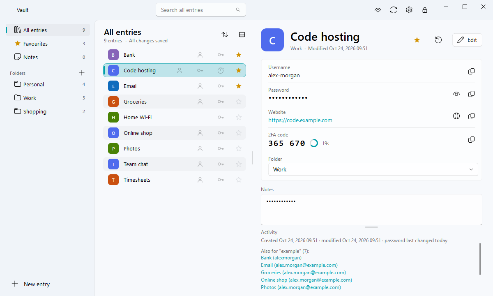
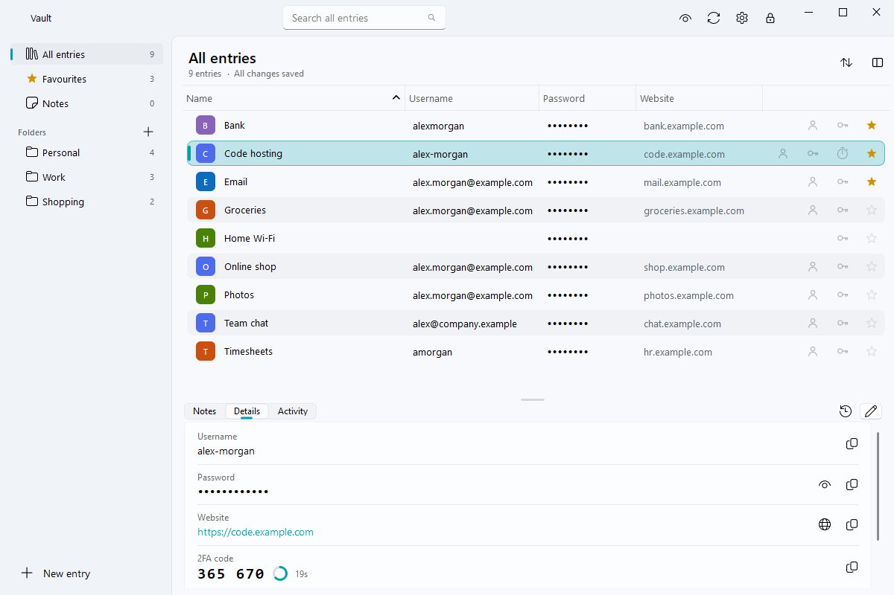
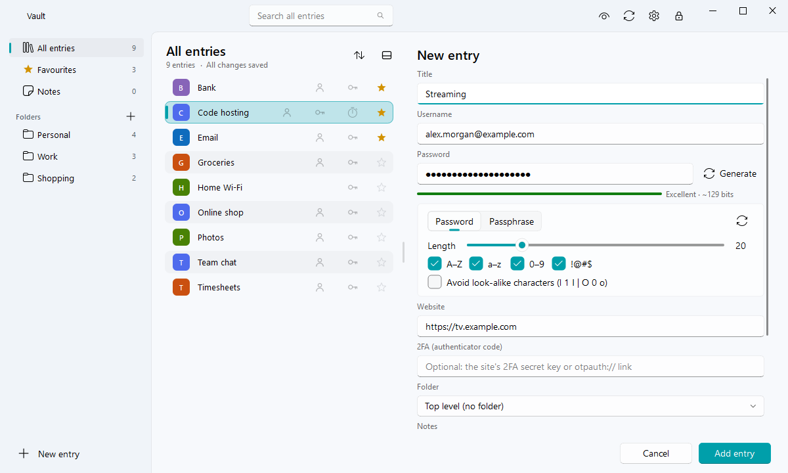

# Vault

A simple, modern password manager for KeePass databases (`.kdbx`), for Windows and Mac. It works
with the same file as KeePass and KeePassXC, for example one kept in Google Drive and used from
several computers.

## Download and run

Get the latest version from the [Releases page](https://github.com/wards999/vault/releases). There's
nothing to install.

- **Windows:** download `Vault-v…-windows.zip`, right-click it → **Extract All**, open the **Vault**
  folder and run **Vault.exe**. Put the folder anywhere you like (Documents, a USB stick…).
- **Mac:** download `Vault-v…-mac.zip`, double-click it, and drag **Vault** into Applications. The app
  isn't signed by Apple, so the first time macOS may refuse to open it. Go to **System Settings →
  Privacy & Security** and click **Open Anyway**.

Then choose your database file, type your master password and click **Unlock**.

## Features

- **A list of entries** with folders alongside, and the selected entry's details beside the list or,
  with the button by **Sort**, below it. Below, the list shows columns (username, password, website,
  folder, modified and created dates) that sort from their headings; right-click a heading to choose
  them, and they give way one by one when the window is narrow. The notes, details and activity
  are then on tabs, and entries are added and edited in a pop-up. The layout, window size, panel
  sizes and last folder are remembered.
- **Quick copying:** double-click an entry to copy its password (or, with the details below the list,
  its username or password) and minimise Vault. The clipboard clears itself after a time you choose.
- **Editing:** add, edit, duplicate and delete entries; create, rename and move folders, including by
  drag and drop. **Undo** brings back deletions and other changes.
- **Password generator** for random passwords or passphrases, with a strength meter and optional
  colour-coding of letters, digits and symbols.
- **Username suggestions** from your other entries while you type (wildcards work).
- **2FA codes (TOTP)** for entries that have them.
- **Search first:** Vault opens with the cursor in the search box; ↓ or Enter moves to the results,
  then Ctrl+C copies the password. Ctrl+F returns to search.
- **History:** right-click → History (Ctrl+H) shows an entry's earlier versions; copy an old password
  or restore a version (undoable).
- **Extra fields and attachments** made in KeePass or KeePassXC (PINs, security answers, files) show
  under the entry, hidden values masked, with copy buttons; attachments can be saved. Entries with
  attachments show a paperclip, and search looks in field names and values.
- **New databases and master passwords:** create a database from the unlock screen; change the master
  password or key file in Settings → Database (a backup that opens with the old password is kept).
- **Copied passwords stay out of clipboard history** (Windows' Win+V history and cloud clipboard, and
  clipboard managers on macOS and Linux).
- **Password health report:** weak, reused, expired and empty passwords, and passwords not changed in
  over a year.
- **Site icons:** downloaded from each website and saved in the database, so KeePass and KeePassXC
  show them too. For entries without a website, **Settings → Find icons by name** guesses the site
  from each entry's name (for your country, e.g. `.co.uk` first) and shows the guesses in a grid to
  tick or correct before anything changes; it can fill in the Website fields too.
- **Themes:** light, dark and several colour themes.
- **List text size:** make the entry list, folders and notes smaller or larger (80–160%), live, with
  Ctrl + mouse wheel, Ctrl+= / Ctrl+− (Ctrl+0 for normal) or in Settings. Folders show their KeePass icons.

## Keeping your passwords safe

- **Auto-save without surprises:** every change is saved straight away. Vault encrypts to memory,
  checks the result can be opened again, then replaces the file in one step, so a failed save can't
  damage it. It keeps up to 10 backups (at most one every 10 minutes).
- **Changes from other computers:** if the file was changed elsewhere (another PC, KeePass or
  KeePassXC), Vault merges both sets of changes and asks only when the same entry was changed in
  both places. Press **F5** to check for changes now.
- **Lock:** Vault locks after a time without use that you choose in Settings (never, or 1 minute to
  1 hour; 5 minutes by default), the moment you lock the computer (Windows+L / Control-Command-Q) or
  it goes to sleep, or straight away with **Lock**. Locking saves any pending changes first and clears
  copied passwords from the clipboard. If Vault is minimised it stays minimised, and asks for the
  password when you open it.
- **Quick Unlock:** after unlocking with your master password, unlock again with **Windows Hello**
  (fingerprint, face or PIN) or **Touch ID** until you quit Vault. As in KeePassXC, the master
  password is never saved: it's kept only in memory, encrypted. You can turn this off in Settings.
- **Private minimising:** the window is covered before it minimises, so taskbar previews, the Dock
  and the macOS minimise animation don't show passwords.
- **File formats:** KDBX 4 files can be edited. Older KDBX 3 files open read-only; to edit one,
  upgrade it to KDBX 4 in KeePassXC's database settings.

## Building (maintainer)

- **Windows:** `powershell -ExecutionPolicy Bypass -File build.ps1` builds the portable zip with PyInstaller.
- **Mac:** `bash build_mac.sh`, which must run on a Mac. GitHub Actions builds both for release tags.
- **Tests:** `python tests/run_all.py` (or `python tests/run_all.py health lock` for some of them). Each
  test runs in its own process with made-up test databases, temporary settings and backups in a
  temporary folder; your real settings and databases are never touched. Install the extras with
  `pip install -r tests/requirements.txt`; KeePassXC is used to cross-check files when it's installed.
  GitHub Actions runs them on every push to main, and before building a release.
- **Release:** set `VERSION` in `vault.py`, commit and push to main. GitHub Actions sees a version
  with no release yet, runs the tests, builds both apps, then creates the tag `v<VERSION>` and
  publishes the release. Pushing the tag yourself also works (for example
  `git tag v1.0.5; git push origin main v1.0.5`); it's refused if the tag doesn't match `VERSION`.

Built with Python, PySide6, [PySide6-Fluent-Widgets](https://github.com/zhiyiYo/PyQt-Fluent-Widgets)
and [pykeepass](https://github.com/libkeepass/pykeepass).
